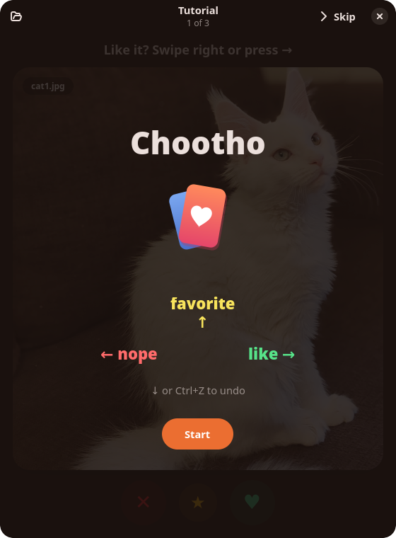
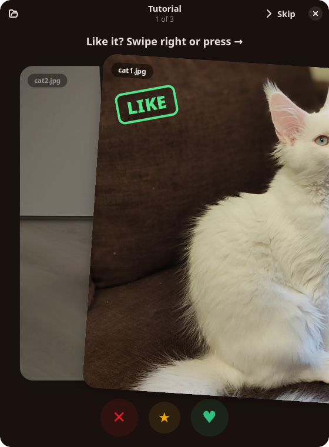
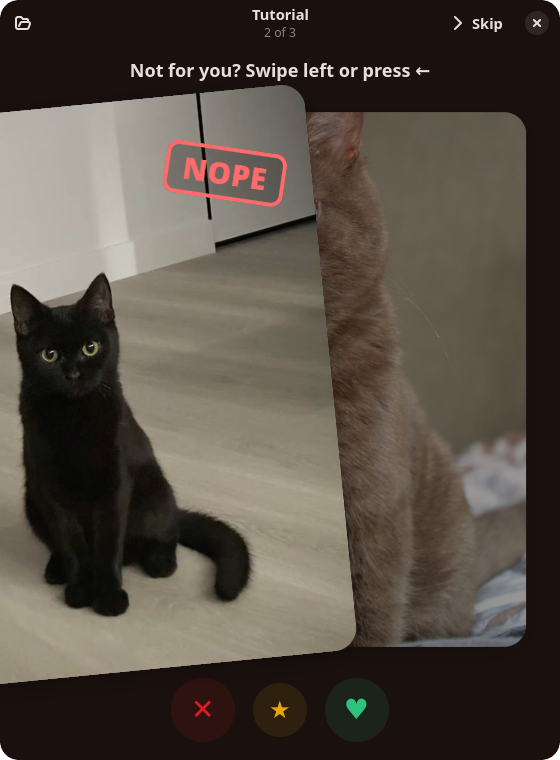
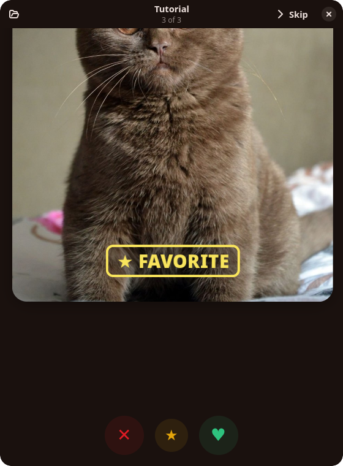
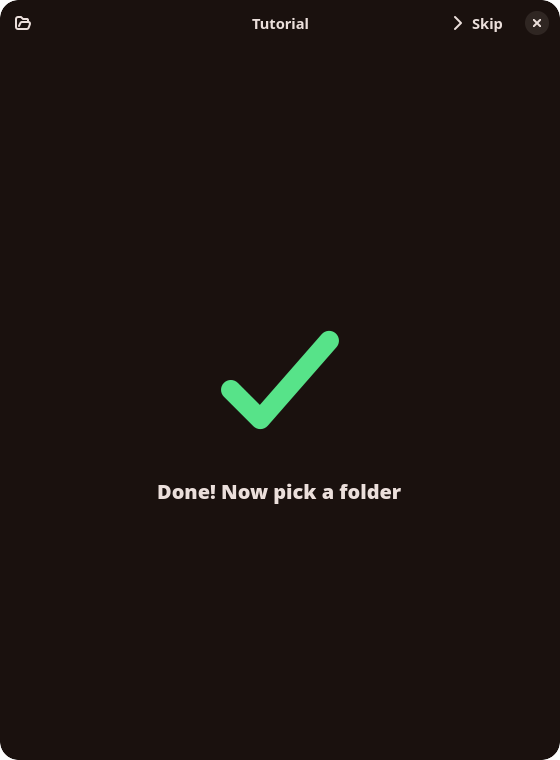

<div align="center">
  
  <h1>Chootho</h1>
  <p><b>Sort a folder of photos, videos and music by swiping.</b></p>
</div>

<p align="center">
  
  
  
  
  
</p>

Chootho shows the files of a folder one card at a time. Swipe a card right to
like it, left to drop it, or up to keep it as a favorite, and the file moves
into `liked/`, `disliked/` or `favorites/` right next to it. Made a mistake?
Undo puts the file back.

- Images, animated GIFs, videos and audio (with cover art)
- Mouse first: drag, fling, or use the buttons under the card
- Keyboard too: <kbd>→</kbd> like, <kbd>←</kbd> nope, <kbd>Space</kbd>/<kbd>↑</kbd> favorite, <kbd>↓</kbd>/<kbd>Ctrl</kbd>+<kbd>Z</kbd> undo
- Files it can't show get an **Open With…** button and still swipe like the rest
- A short tutorial with three cats on first launch
- Native GTK 4 + libadwaita, written in Rust, ~2 MB

## Install

Grab `Chootho-x86_64.AppImage` from the [latest release](https://github.com/wioletowa/Chootho/releases/latest), then:

```sh
chmod +x Chootho-x86_64.AppImage
./Chootho-x86_64.AppImage ~/Pictures/some-folder
```

The AppImage uses the system's GTK, so it needs GTK ≥ 4.14, libadwaita ≥ 1.5
and GStreamer (Ubuntu 24.04, Fedora 40 or newer). For H.264 video install
`gst-libav`.

### Build from source

```sh
cargo build --release
./target/release/chootho [folder]
```

## License

[MIT](LICENSE)
